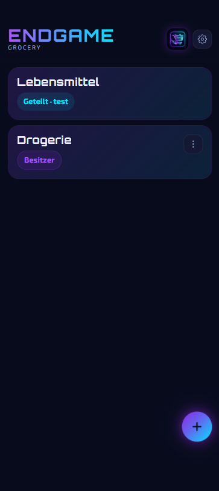
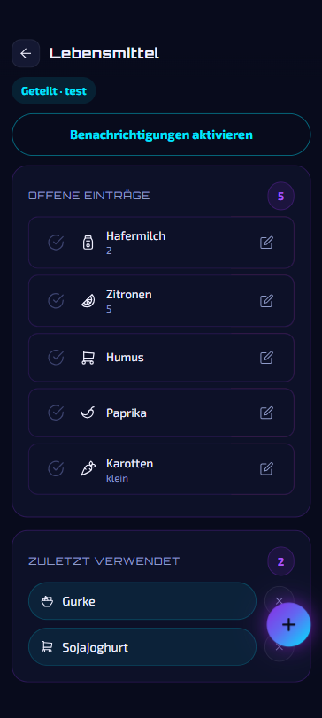
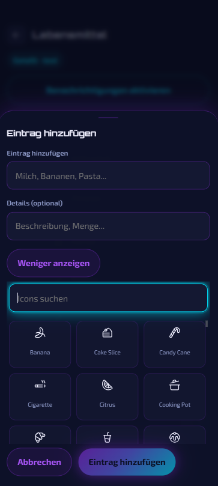

<p align="center">
  
</p>

<p align="center">
  
  <a href="./LICENSE">
    
  </a>
</p>

# endgame_grocery

Shared grocery list monorepo with a React frontend, an Express backend, and PostgreSQL persistence.

Plan, share and tick off groceries together — with live updates, offline support and an installable app.

## Features

<p align="center">
  
  &nbsp;&nbsp;&nbsp;
  
  &nbsp;&nbsp;&nbsp;
  
</p>

- **Shared lists and invites** — create lists, share them with family or flatmates by email invite and see who is on them.
- **Fast item entry** — add items with optional details (quantity, brand), autocomplete with typo tolerance and a recently used history.
- **Icons for every item** — icons are suggested locally in your browser, so item text never leaves your device. Pick another icon any time.
- **Live updates** — changes by other members appear immediately, without reloading.
- **Notifications** — optional browser push messages when someone adds items to a shared list, batched so they do not spam.
- **Works offline** — installable PWA that shows your lists without a connection and syncs your changes when you are back online. An expired access session shows a [Reconnect action](docs/SETUP.md#expired-access-session-or-cloudflare-challenge-stuck-offline-mode), keeping queued changes.
- **English and German** — follows your browser language and can be switched in the app.
- **Home Assistant and REST API** — integrate with an API key; Swagger documentation is served at `/api/docs/` on a running instance.
- **Accounts and security** — email verification, password reset, rate limiting and hardened security headers.

## Quick start

Run the app with Docker (needs Docker with Compose support):

```bash
cp docker-compose.example.yml docker-compose.yml
# edit docker-compose.yml and replace every "change-me" value
docker compose up -d
```

Then open `http://localhost:80`. Database migrations run automatically on start. See [docs/SETUP.md](docs/SETUP.md) for configuration, push notifications and production hints.

## Documentation

- [Setup](docs/SETUP.md) — install, configure and operate a deployment (Docker, environment variables, push notifications, Cloudflare, security).
- [Development](docs/DEVELOPMENT.md) — local development, tests, CI/CD, architecture and the detailed behavior and API reference.
- API docs — Swagger UI at `/api/docs/` on a running instance.

## Built With

This project is vibe-coded with aide, the AI workflow tooling from [agentinit](https://github.com/riadshalaby/agentinit).

## Support

<a href="https://www.buymeacoffee.com/derflodev">
  
</a>

[](https://github.com/sponsors/DerFloDev)

## License

This project is licensed under the [GNU General Public License v3.0](./LICENSE).
